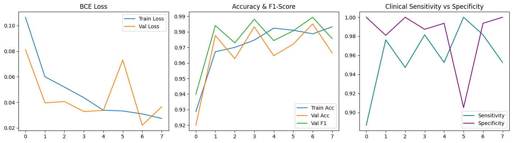
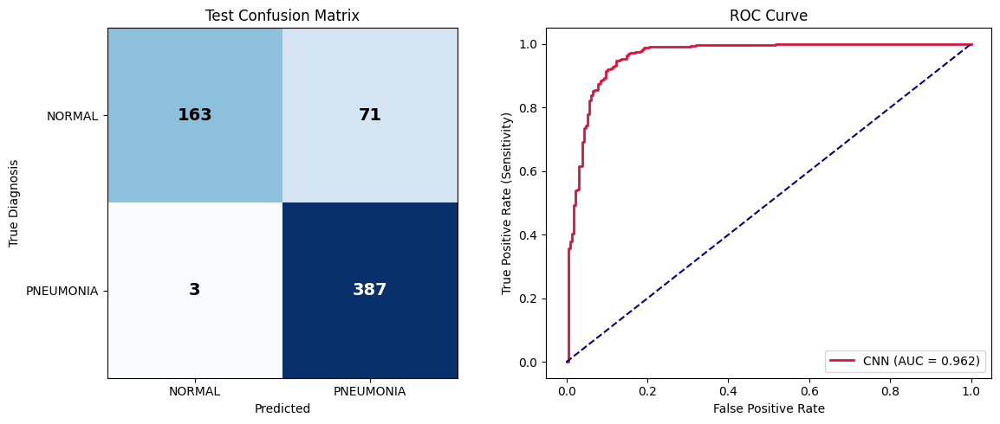
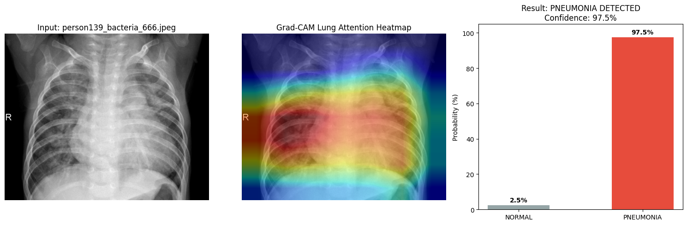

# Pneumonia Detection from Chest X-Ray Images Using Convolutional Neural Network (CNN)

  

  <strong>BRAINWARE UNIVERSITY</strong> 
  398, Ramkrishnapur Road, Barasat, North 24 Parganas, Kolkata – 700 125 
  <strong>Department of Computational Sciences</strong>

<h3 align="center">A PROJECT REPORT</h3>

  Submitted by 
  <strong>RITAM BHOUMIK</strong> 
  Student Code: <code>BWU/BCA/24/160</code>  
  <em>in partial fulfilment for the award of the degree of</em> 
  <strong>BACHELOR OF COMPUTER APPLICATIONS (HONOURS)</strong>  
  <strong>NOVEMBER 2026</strong>

---

## BONAFIDE CERTIFICATE

Certified that this project report **“Pneumonia Detection from Chest X-Ray Images Using Convolutional Neural Network (CNN)”** is the bonafide work of **“Ritam Bhoumik (BWU/BCA/24/160)”** who carried out the project work under my supervision.

- **Project Supervisor**: __________________________________________
- **Signature**: __________________________________________
- **Date**: __________________________________________

---

## ACKNOWLEDGEMENT

I express my sincere gratitude to **Brainware University** and the faculty members of the **Department of Computational Sciences** for providing the academic environment and resources needed to complete this project on pneumonia detection from chest X-ray images using a Convolutional Neural Network.

I would like to thank my project supervisor for guidance, feedback, and encouragement during the development of this work. I also acknowledge the creators of the chest X-ray pneumonia image dataset, the contributor who made it available on Kaggle, and the developers of the open-source Python, PyTorch, torchvision, scikit-learn, Matplotlib, NumPy, Pillow and tqdm libraries and the Google Colab platform used in this project.

Finally, I thank my family and well-wishers for their support throughout the completion of this academic project. The report describes an academic experiment and its results; it is not intended to provide medical diagnosis or treatment advice.

- **Student Name**: Ritam Bhoumik  
- **Student Code**: BWU/BCA/24/160  
- **Signature**: ______________________________  
- **Date**: __________________________________  

---

## ABSTRACT

Pneumonia is an infection of the lungs that is commonly assessed with the help of chest radiographs. Reading a chest X-ray requires expertise, and subtle differences between normal and abnormal lung appearance can be difficult to judge consistently. This project develops an image-classification pipeline using a Convolutional Neural Network (CNN) implemented in PyTorch to classify chest X-ray images into two categories: **NORMAL** and **PNEUMONIA**.

The notebook downloads the Chest X-Ray Pneumonia dataset from Kaggle, which contains 5,216 training, 16 validation and 624 test images. Because the official validation set is very small, 10% of the training images are moved to the validation set, giving 4,695 training, 537 validation and 624 test images. Images are resized to 224 × 224 pixels, converted to three-channel RGB and normalized with ImageNet statistics. Training images are augmented with small rotations, affine shifts and scaling, horizontal flips and brightness and contrast jitter.

The final model is a ResNet-18 CNN initialised with ImageNet weights, in which the original classifier is replaced by a head with 512-to-128 and 128-to-1 linear layers, batch normalization, ReLU and dropout of 0.4. It is trained for 8 epochs with the AdamW optimizer (learning rate 1e-4, weight decay 1e-2), a class-weighted binary cross-entropy loss (pos_weight 0.340) and a ReduceLROnPlateau scheduler. The checkpoint with the best validation F1-score (0.9894, epoch 7) is kept. Grad-CAM heatmaps are generated to show which image regions influence a prediction.

On the 624 independent test images the model achieves an **accuracy of 88.14%**, **sensitivity (recall for pneumonia) of 99.23%**, **specificity of 69.66%**, **F1-score of 0.9127** and **ROC-AUC of 0.9621**. The confusion matrix contains 163 true negatives, 71 false positives, 3 false negatives and 387 true positives. The model therefore rarely misses pneumonia but incorrectly flags a substantial share of normal radiographs.

> **Disclaimer**: This is an academic image-classification experiment, not a clinically validated system. It must not be used for diagnosis, treatment selection or other medical decisions.

**Keywords**: Pneumonia detection, chest X-ray, Convolutional Neural Network, CNN, ResNet-18, transfer learning, Grad-CAM, PyTorch, deep learning.

---

## TABLE OF CONTENTS

- [CHAPTER 1: INTRODUCTION](#chapter-1-introduction)
  - [1.1 Background](#11-background)
  - [1.2 Problem Statement](#12-problem-statement)
  - [1.3 Aim and Scope](#13-aim-and-scope)
  - [1.4 Report Organization](#14-report-organization)
- [CHAPTER 2: LITERATURE REVIEW](#chapter-2-literature-review)
  - [2.1 Pneumonia and Chest Radiography](#21-pneumonia-and-chest-radiography)
  - [2.2 Deep Learning for Medical Image Classification](#22-deep-learning-for-medical-image-classification)
  - [2.3 Convolutional Neural Networks and Their Components](#23-convolutional-neural-networks-and-their-components)
  - [2.4 Residual Networks and Transfer Learning](#24-residual-networks-and-transfer-learning)
  - [2.5 Chest X-Ray Pneumonia Dataset](#25-chest-x-ray-pneumonia-dataset)
  - [2.6 Class Imbalance and Evaluation Metrics](#26-class-imbalance-and-evaluation-metrics)
  - [2.7 Explainability with Grad-CAM](#27-explainability-with-grad-cam)
- [CHAPTER 3: THEORY, METHODOLOGY, MATERIALS & METHODS](#chapter-3-theory-methodology-materials--methods)
  - [3.1 Dataset Description](#31-dataset-description)
  - [3.2 Data Loading and Organization](#32-data-loading-and-organization)
  - [3.3 Preprocessing, Augmentation and Data Splitting](#33-preprocessing-augmentation-and-data-splitting)
  - [3.4 CNN Model Development](#34-cnn-model-development)
  - [3.5 Training Procedure](#35-training-procedure)
  - [3.6 Evaluation Metrics](#36-evaluation-metrics)
  - [3.7 Grad-CAM and Diagnostic Report](#37-grad-cam-and-diagnostic-report)
  - [3.8 System Workflow](#38-system-workflow)
  - [3.9 Software and Tools](#39-software-and-tools)
- [CHAPTER 4: RESULTS, ANALYSIS & DISCUSSIONS](#chapter-4-results-analysis--discussions)
  - [4.1 Experimental Setup](#41-experimental-setup)
  - [4.2 Training and Validation Performance](#42-training-and-validation-performance)
  - [4.3 Test-Set Evaluation](#43-test-set-evaluation)
  - [4.4 Grad-CAM Visualization](#44-grad-cam-visualization)
  - [4.5 Discussion](#45-discussion)
- [CHAPTER 5: CONCLUSION, FUTURE SCOPE, LIMITATIONS](#chapter-5-conclusion-future-scope-limitations)
  - [5.1 Conclusion](#51-conclusion)
  - [5.2 Limitations](#52-limitations)
  - [5.3 Future Scope](#53-future-scope)
- [APPENDICES](#appendices)
- [REFERENCES](#references)

---

## LIST OF TABLES

- **Table 3.1**: Class distribution of the Chest X-Ray Pneumonia dataset (original and used splits)
- **Table 3.2**: ResNet-18 transfer-learning model architecture
- **Table 3.3**: Training configuration
- **Table 3.4**: Software and implementation tools
- **Table 4.1**: Training progress across 8 epochs
- **Table 4.2**: Confusion matrix on the test set
- **Table 4.3**: Test-set performance metrics
- **Table 4.4**: Class-wise metrics derived from the confusion matrix

---

## LIST OF FIGURES

- **Figure 4.1**: Training and validation curves: loss, accuracy/F1-score, and sensitivity/specificity
- **Figure 4.2**: Test-set confusion matrix and ROC curve
- **Figure 4.3**: Example diagnostic report with Grad-CAM heatmap

---

## LIST OF SYMBOLS, ABBREVIATIONS AND NOMENCLATURE

| Term | Description |
| :--- | :--- |
| **AI** | Artificial Intelligence |
| **CNN** | Convolutional Neural Network |
| **ResNet** | Residual Network |
| **Grad-CAM** | Gradient-weighted Class Activation Mapping |
| **ROC** | Receiver Operating Characteristic curve |
| **AUC** | Area Under the ROC Curve |
| **ReLU** | Rectified Linear Unit activation function |
| **LeakyReLU** | Leaky Rectified Linear Unit activation function |
| **RGB** | Red, Green and Blue image channels |
| **CPU** | Central Processing Unit |
| **GPU** | Graphics Processing Unit |
| **AdamW** | Adam optimizer with decoupled weight decay |
| **BCE** | Binary Cross-Entropy loss |
| **Logit** | Raw (pre-sigmoid) output score of the network |
| **Epoch** | One complete pass through the training dataset |
| **Batch size** | Number of training examples processed before an optimizer update |
| **TP / TN** | True Positive / True Negative |
| **FP / FN** | False Positive / False Negative |
| **Sensitivity (Recall)** | Proportion of actual pneumonia images correctly identified |
| **Specificity** | Proportion of actual normal images correctly identified |
| **Precision** | Proportion of predictions for a class that are correct |
| **F1-score** | Harmonic mean of precision and recall |

---

# CHAPTER 1: INTRODUCTION

### 1.1 Background
Pneumonia is an infection that inflames the air sacs of one or both lungs. A chest X-ray is one of the most common imaging examinations used to look for signs of pneumonia, such as areas of increased opacity in the lung fields. Interpreting a radiograph, however, depends on the experience of the person reading it, and image quality, patient positioning and overlapping anatomical structures can make the assessment difficult.

Deep learning, and in particular Convolutional Neural Networks, can learn visual features directly from pixel data. Early convolutional layers learn simple patterns such as edges and textures, while deeper layers combine them into more complex representations. When a labelled image collection is limited, a network that has already been trained on a large general image dataset can be reused and fine-tuned, an approach known as transfer learning. This project applies a CNN to classify chest X-ray images as NORMAL or PNEUMONIA.

### 1.2 Problem Statement
Examining a large number of chest radiographs manually requires time and specialist expertise. A computer-vision model may assist research by learning patterns from labelled images, but the task is challenging: the dataset contains more pneumonia than normal images, and a model that scores well on validation data may not perform equally on an independent test set. The project investigates how well a fine-tuned CNN separates normal and pneumonia chest X-rays, and how its errors are distributed between false alarms and missed cases.

### 1.3 Aim and Scope
The aim is to implement and evaluate a binary chest X-ray classifier using PyTorch and the Chest X-Ray Pneumonia dataset. The specific objectives are:
1. Download the dataset from Kaggle, organize it into train, validation and test folders, and enlarge the very small official validation set by moving 10% of the training images into it.
2. Build a data pipeline with resizing, augmentation and ImageNet normalization, and create PyTorch Dataset and DataLoader objects.
3. Fine-tune a ResNet-18 CNN with a custom classification head, using a class-weighted loss and checkpointing on the best validation F1-score.
4. Evaluate the saved model on the independent test set using accuracy, sensitivity, specificity, F1-score, ROC-AUC, a confusion matrix and a ROC curve.
5. Use Grad-CAM to visualize image regions that influence a prediction and produce a simple diagnostic report for an individual radiograph.

The scope is limited to the notebook implementation. The notebook also defines a smaller custom CNN (PneumoniaCNN), but the reported results are from the ResNet-18 transfer-learning model. The code does not include external clinical validation, patient-level data separation checks or a deployed diagnostic application.

### 1.4 Report Organization
Chapter 1 introduces the project and its objectives. Chapter 2 reviews the relevant concepts and dataset. Chapter 3 describes the methodology. Chapter 4 presents the training curves, test-set results and Grad-CAM output. Chapter 5 gives the conclusion, limitations and future scope. Appendices and references follow.

---

# CHAPTER 2: LITERATURE REVIEW

### 2.1 Pneumonia and Chest Radiography
Pneumonia is a lung infection that can be caused by bacteria, viruses or other organisms, and it remains an important cause of illness and death, particularly among young children, according to the World Health Organization. Chest radiography is widely used to support the diagnosis. Bacterial pneumonia often appears as a focal region of consolidation, whereas viral pneumonia tends to show a more diffuse pattern; normal radiographs show clear lung fields. These visual differences motivate the use of image-analysis methods.

### 2.2 Deep Learning for Medical Image Classification
Image classification assigns an input image to one of a set of predefined categories. Traditional pipelines relied on hand-designed features, whereas deep learning learns representations directly from labelled examples. CNNs have been applied to medical imaging tasks including skin lesion, retinal and chest radiograph analysis, and published studies on chest X-rays report that deep networks can approach the performance of human readers on specific tasks under controlled conditions (Rajpurkar et al., 2017). Such results do not by themselves establish clinical readiness, because performance depends on the dataset, the labelling and the evaluation protocol.

### 2.3 Convolutional Neural Networks and Their Components
A CNN applies learnable filters to an input image. Each convolution produces feature maps that respond to local visual patterns, and the filter weights are learned through backpropagation and an optimization algorithm. The main components relevant to this project are:
- **Convolution layers** learn local spatial patterns such as edges, textures and shapes.
- **Batch normalization** normalizes layer activations within a mini-batch, which stabilizes and speeds up training.
- **Activation functions** such as ReLU and LeakyReLU introduce non-linearity.
- **Pooling layers** reduce the spatial size of feature maps; global average pooling summarizes each feature map by a single value.
- **Dropout** randomly disables units during training to reduce over-fitting.
- **Fully connected layers** combine the extracted features and produce the output score.

### 2.4 Residual Networks and Transfer Learning
Residual Networks (ResNets) add shortcut connections that let a layer learn a correction to its input rather than a complete transformation, which makes deeper networks easier to train (He et al., 2016). ResNet-18 is the smallest commonly used variant, with 18 weight layers organized in four residual stages. In transfer learning, the weights of a network pretrained on a large dataset such as ImageNet are used as the starting point, and the network is then fine-tuned on the target task. This usually requires less data and training time than training from random initialization, which suits datasets of a few thousand images.

### 2.5 Chest X-Ray Pneumonia Dataset
The dataset used in this project is the Chest X-Ray Pneumonia collection distributed on Kaggle, derived from the data released by Kermany et al. (2018). It contains anterior–posterior chest radiographs from paediatric patients, arranged in train, validation and test folders with two classes: NORMAL and PNEUMONIA. The notebook downloads it with the `kagglehub` library from the dataset identifier `paultimothymooney/chest-xray-pneumonia`.

### 2.6 Class Imbalance and Evaluation Metrics
In the training folder, pneumonia images outnumber normal images by nearly three to one. A model trained on imbalanced data can reach a high overall accuracy while performing poorly on the minority class, so accuracy alone is not sufficient. In medical screening, sensitivity (the proportion of true cases detected) and specificity (the proportion of healthy cases correctly cleared) are reported separately, together with precision, F1-score and the area under the ROC curve. Class-weighted loss functions are one common way to reduce the effect of imbalance during training.

### 2.7 Explainability with Grad-CAM
Gradient-weighted Class Activation Mapping (Grad-CAM) produces a coarse heatmap that highlights the image regions that contributed most to a prediction. It uses the gradients of the output score with respect to the feature maps of a chosen convolutional layer to weight those feature maps, and it keeps only the positive contributions (Selvaraju et al., 2017). Grad-CAM helps a reader check whether a model attends to the lung region rather than to irrelevant artefacts, but it is an aid to interpretation, not proof that a prediction is correct.

---

# CHAPTER 3: THEORY, METHODOLOGY, MATERIALS & METHODS

### 3.1 Dataset Description
The notebook downloads the Chest X-Ray Pneumonia dataset (an archive of about 2.29 GB) from Kaggle and organizes it into train, val and test folders under a local data directory. Each folder contains two sub-folders, NORMAL and PNEUMONIA. The number of images found by the notebook is shown in Table 3.1.

#### Table 3.1: Class distribution of the Chest X-Ray Pneumonia dataset
| Split | NORMAL | PNEUMONIA | Total | Note |
| :--- | :---: | :---: | :---: | :--- |
| **Train (original)** | 1,341 | 3,875 | 5,216 | Official training folder |
| **Validation (original)** | 8 | 8 | 16 | Official validation folder |
| **Test** | 234 | 390 | 624 | Used only for final evaluation |
| **Train (used)** | – | – | 4,695 | After moving 10% to validation |
| **Validation (used)** | – | – | 537 | 16 original + 521 from training |

The original validation folder holds only 16 images, which is too few for stable model selection. The notebook therefore shuffles the training images with a fixed random seed of 42 and moves 10% of them (521 images) to the validation set. The test set is left unchanged. Pneumonia images make up about 74% of the original training folder and 62.5% of the test folder.

### 3.2 Data Loading and Organization
The notebook first verifies that a CUDA-capable GPU is available (a Tesla T4 on Google Colab in the recorded run) and installs the required libraries. It downloads the dataset using `kagglehub` and copies the train, val and test folders into a local data directory. A scanning function walks through each split, reads the NORMAL and PNEUMONIA folders (matching folder names case-insensitively) and collects the paths of all JPEG and PNG images. Class labels are encoded as NORMAL = 0 and PNEUMONIA = 1.

A custom `ChestXRayDataset` class stores the list of (image path, label) pairs. For each item it opens the image, converts it to three-channel RGB, applies the transformation pipeline and returns the image tensor together with the label as a floating-point value, as required by the binary loss function.

### 3.3 Preprocessing, Augmentation and Data Splitting
All images are resized to 224 × 224 pixels, converted to tensors and normalized with the ImageNet channel means `[0.485, 0.456, 0.406]` and standard deviations `[0.229, 0.224, 0.225]`, so that the inputs match the statistics expected by the pretrained ResNet-18 weights. The training pipeline additionally applies the following random augmentations to improve generalization:
- Random rotation of up to 10 degrees;
- Random affine translation of up to 5% in each direction and scaling between 0.95 and 1.05;
- Random horizontal flip with probability 0.5;
- Colour jitter with brightness and contrast factors of 0.15.

Validation and test images receive only resizing and normalization. DataLoaders use a batch size of 32 and two worker processes; the training loader shuffles the data, whereas the validation and test loaders do not. The positive-class weight for the loss function is computed from the final training set as the number of NORMAL images divided by the number of PNEUMONIA images, which gives **0.340**.

### 3.4 CNN Model Development

#### 3.4.1 ResNet-18 transfer-learning model (used for reported results)
The final model, named `PneumoniaTransferNet` in the notebook, is a torchvision ResNet-18 initialised with the default ImageNet weights. The original 1000-class output layer is replaced by a new classification head. All parameters of the network are fine-tuned. The model returns a single logit; a sigmoid function converts it to the probability of pneumonia, and a probability of at least 0.5 is classified as PNEUMONIA.

#### Table 3.2: ResNet-18 transfer-learning model architecture
| Layer / component | Configuration |
| :--- | :--- |
| **Input** | RGB image, 224 × 224 pixels |
| **Backbone** | torchvision ResNet-18 with ImageNet pretrained weights (convolution stem, four residual stages, global average pooling), 512 output features |
| **Head: Linear** | 512 to 128 |
| **Head: BatchNorm1d** | 128 features |
| **Head: ReLU** | In-place activation |
| **Head: Dropout** | Probability 0.4 |
| **Head: Linear (output)**| 128 to 1 (single logit) |
| **Output** | Sigmoid probability of PNEUMONIA; threshold 0.5 |
| **Grad-CAM target layer**| Final convolution of the last residual block (`layer4[-1].conv2`) |

#### 3.4.2 Custom PneumoniaCNN (defined in notebook)
The notebook also defines a smaller custom network, `PneumoniaCNN`, that can be selected with `model_type="custom"`. It contains four convolutional blocks with 32, 64, 128 and 256 filters. Each block has two 3 × 3 convolutions, each followed by batch normalization and LeakyReLU (slope 0.1), then 2 × 2 max pooling and spatial dropout (0.1, 0.2, 0.25 and 0.3 respectively). A global average pooling layer feeds a classifier with a 256-to-128 linear layer, batch normalization, LeakyReLU, dropout of 0.4 and a 128-to-1 output layer.

### 3.5 Training Procedure
The model is trained for 8 epochs using the AdamW optimizer with a learning rate of 1e-4 and weight decay of 1e-2. The loss function is `BCEWithLogitsLoss` with the positive-class weight of 0.340, which reduces the influence of the majority pneumonia class. A `ReduceLROnPlateau` scheduler monitors the validation F1-score and halves the learning rate if it does not improve for two epochs.

#### Table 3.3: Training configuration
| Parameter | Value |
| :--- | :--- |
| **Model** | ResNet-18 (ImageNet pretrained) with custom head |
| **Optimizer** | AdamW |
| **Learning rate** | 1e-4 |
| **Weight decay** | 1e-2 |
| **Loss function** | `BCEWithLogitsLoss`, pos_weight = 0.340 |
| **Scheduler** | ReduceLROnPlateau (mode: max on val F1, factor 0.5, patience 2) |
| **Epochs** | 8 |
| **Batch size** | 32 |
| **Image size** | 224 × 224 |
| **Dropout (head)** | 0.4 |
| **Checkpoint rule** | Save weights when validation F1-score improves |
| **Data split** | 4,695 train / 537 validation / 624 test (seed 42) |
| **Hardware** | NVIDIA Tesla T4 GPU (Google Colab) |

### 3.6 Evaluation Metrics
After training, the best checkpoint is loaded, the model is switched to evaluation mode and gradient calculation is disabled while the test loader is processed. Predicted probabilities are thresholded at 0.5 and compared with true labels:
- **Accuracy** = (TP + TN) / (TP + TN + FP + FN)
- **Sensitivity (Recall)** = TP / (TP + FN)
- **Specificity** = TN / (TN + FP)
- **Precision** = TP / (TP + FP); **F1-score** = 2 × precision × recall / (precision + recall)
- **ROC-AUC**: Area under the curve of sensitivity against the false-positive rate over all thresholds.

### 3.7 Grad-CAM and Diagnostic Report
The notebook implements a `GradCAM` class that registers forward and backward hooks on the last convolutional layer of the network (`layer4[-1].conv2`). It back-propagates the output score, averages the gradients of each feature map, weights the activations by these averages, keeps the positive part of their mean and normalizes the result to the range 0 to 1. The heatmap is resized and overlaid on the original X-ray.

### 3.8 System Workflow
1. GPU check and installation of dependencies.
2. Dataset download, folder organization and class counting.
3. Image scanning, label encoding and validation-set enlargement.
4. Preprocessing and augmentation; Dataset and DataLoader creation.
5. ResNet-18 initialization with a new classification head.
6. Training with validation monitoring and best-checkpoint saving.
7. Test-set evaluation with confusion matrix and ROC curve.
8. Grad-CAM visualization and single-image diagnostic report.

### 3.9 Software and Tools
#### Table 3.4: Software and implementation tools
| Tool / Library | Purpose |
| :--- | :--- |
| **Python** | Core programming language |
| **PyTorch** | Model definition, training and inference (v2.14.1+cu130) |
| **torchvision** | ResNet-18 model, pretrained weights and image transformations |
| **kagglehub** | Downloading the dataset from Kaggle |
| **NumPy** | Numerical operations |
| **Pillow (PIL)** | Image loading and RGB conversion |
| **scikit-learn** | Evaluation metrics, confusion matrix and ROC curve |
| **Matplotlib** | Training curves, confusion matrix, ROC curve and diagnostic report |
| **tqdm** | Progress bars during training |
| **Google Colab** | Notebook execution environment with Tesla T4 GPU |

---

# CHAPTER 4: RESULTS, ANALYSIS & DISCUSSIONS

### 4.1 Experimental Setup
The notebook trains the ResNet-18 transfer-learning model for 8 epochs on 4,695 training images and monitors it on 537 validation images. The best checkpoint, selected by validation F1-score, is then evaluated once on the 624 test images of the official test folder.

### 4.2 Training and Validation Performance
Table 4.1 lists the epoch-wise results, and Figure 4.1 plots them. Training loss falls steadily from 0.1066 in epoch 1 to 0.0274 in epoch 8, while training accuracy rises from 92.9% to 98.3%. Validation accuracy ranges between 92.0% and 98.5% and validation F1-score between 0.940 and 0.989.

#### Table 4.1: Training progress across 8 epochs
| Epoch | Train loss | Train acc | Val loss | Val acc | Val sens. | Val spec. | Val F1 |
| :---: | :---: | :---: | :---: | :---: | :---: | :---: | :---: |
| 1 | 0.1066 | 0.929 | 0.0812 | 0.920 | 0.887 | 1.000 | 0.940 |
| 2 | 0.0600 | 0.967 | 0.0396 | 0.978 | 0.976 | 0.981 | 0.984 |
| 3 | 0.0520 | 0.970 | 0.0406 | 0.963 | 0.947 | 1.000 | 0.973 |
| 4 | 0.0437 | 0.975 | 0.0329 | 0.983 | 0.982 | 0.987 | 0.988 |
| 5 | 0.0338 | 0.982 | 0.0336 | 0.965 | 0.953 | 0.994 | 0.974 |
| 6 | 0.0333 | 0.981 | 0.0731 | 0.972 | 1.000 | 0.905 | 0.981 |
| **7** | **0.0309** | **0.979** | **0.0221** | **0.985** | **0.982** | **0.994** | **0.989** |
| 8 | 0.0274 | 0.983 | 0.0365 | 0.966 | 0.953 | 1.000 | 0.976 |

  
   
  <em>Figure 4.1: Training and validation curves – BCE loss (left), accuracy and F1-score (centre), sensitivity and specificity (right).</em>

The best validation F1-score of **0.9894** occurred at **epoch 7** (validation accuracy 98.5%, sensitivity 0.982, specificity 0.994, validation loss 0.0221), and this checkpoint was saved as `best_model_resnet.pth` and used for the test evaluation.

### 4.3 Test-Set Evaluation
Figure 4.2 shows the test-set confusion matrix and the ROC curve of the saved model. Of the 390 pneumonia images, 387 are correctly detected and 3 are missed. Of the 234 normal images, 163 are correctly identified and 71 are incorrectly classified as pneumonia.

  
   
  <em>Figure 4.2: Test-set confusion matrix (left) and ROC curve with AUC = 0.962 (right).</em>

#### Table 4.2: Confusion matrix on the test set
| Actual class | Predicted NORMAL | Predicted PNEUMONIA | Total |
| :--- | :---: | :---: | :---: |
| **NORMAL** | 163 (TN) | 71 (FP) | 234 |
| **PNEUMONIA** | 3 (FN) | 387 (TP) | 390 |
| **Total** | 166 | 458 | 624 |

#### Table 4.3: Test-set performance metrics
| Metric | Value | Meaning |
| :--- | :---: | :--- |
| **Accuracy** | **88.14%** | 550 of 624 test images classified correctly |
| **Sensitivity (Recall)** | **99.23%** | 387 of 390 pneumonia images detected |
| **Specificity** | **69.66%** | 163 of 234 normal images identified |
| **F1-score** | **0.9127** | F1 for the PNEUMONIA class |
| **ROC-AUC** | **0.9621** | Separability of the two classes across all thresholds |

#### Table 4.4: Class-wise metrics derived from the confusion matrix
| Class | Test images | Precision | Recall | F1-score |
| :--- | :---: | :---: | :---: | :---: |
| **NORMAL** | 234 | 98.19% | 69.66% | 0.8150 |
| **PNEUMONIA** | 390 | 84.50% | 99.23% | 0.9127 |
| **Macro average** | 624 | 91.35% | 84.44% | 0.8639 |
| **Weighted average** | 624 | 89.63% | 88.14% | 0.8761 |

### 4.4 Grad-CAM Visualization
Figure 4.3 shows the diagnostic report generated for the sample test radiograph `person139_bacteria_666.jpeg`. The model classifies it as PNEUMONIA with a confidence of 97.5% (NORMAL probability 2.5%). The Grad-CAM overlay concentrates the model’s attention on the mid-chest region, with the strongest activation over the right side of the patient and extending toward the centre of the chest.

  
   
  <em>Figure 4.3: Example diagnostic report – input X-ray (left), Grad-CAM heatmap overlay (centre) and class probabilities (right).</em>

### 4.5 Discussion
- **Strength**: High sensitivity (99.23%) and ROC-AUC of 0.9621. The network rarely misses pneumonia cases (only 3 missed out of 390).
- **Weakness**: Moderate specificity (69.66%), resulting in 71 false alarms out of 234 normal radiographs.
- **Validation vs Test Gap**: Validation accuracy reaches 98.5% while test accuracy is 88.14%. The small official validation set and lack of patient-level grouping likely account for this discrepancy.

---

# CHAPTER 5: CONCLUSION, FUTURE SCOPE, LIMITATIONS

### 5.1 Conclusion
This project implemented an end-to-end binary pneumonia-detection pipeline for chest X-ray images using a ResNet-18 Convolutional Neural Network in PyTorch. Over 8 epochs, the model attained an accuracy of 88.14%, sensitivity of 99.23%, specificity of 69.66%, F1-score of 0.9127 and ROC-AUC of 0.9621 on 624 independent test images.

### 5.2 Limitations
1. Single dataset, single split, and 8 epochs of training without cross-dataset generalization testing.
2. Validation split was randomly sampled without verifying patient separation.
3. Test specificity is 69.66%; the 0.5 decision threshold was not tuned.
4. Binary classification only (does not differentiate bacterial vs viral pneumonia).

### 5.3 Future Scope
1. Patient-level data partitioning and stratified k-fold cross-validation.
2. Threshold tuning to optimize the trade-off between sensitivity and specificity.
3. Comparing ResNet-18 with deeper architectures (ResNet-50, DenseNet-121, EfficientNet).
4. Multi-class classification (Normal vs Bacterial vs Viral).
5. Higher-resolution Grad-CAM variants and radiologist clinical evaluation.

---

## APPENDICES

### Appendix A: Dataset Classes
| Encoded label | Class name | Description |
| :---: | :--- | :--- |
| **0** | NORMAL | Chest X-ray without signs of pneumonia |
| **1** | PNEUMONIA | Chest X-ray labelled as pneumonia (positive class) |

### Appendix B: Main Implementation Components
| Component | Implementation in the notebook |
| :--- | :--- |
| **Data source** | Kaggle dataset `paultimothymooney/chest-xray-pneumonia` via `kagglehub` |
| **Validation set** | 16 official images + 10% of training images (seed 42) |
| **Image transform** | Resize 224 × 224, ToTensor, ImageNet normalization |
| **Augmentations** | Rotation 10°, affine shift/scale, horizontal flip, brightness/contrast jitter |
| **Model** | ResNet-18 with custom 512-128-1 head |
| **Training** | 8 epochs, AdamW (lr 1e-4), BCEWithLogitsLoss (pos_weight 0.340), ReduceLROnPlateau |
| **Checkpoint** | `best_model_resnet.pth` saved on best validation F1-score |
| **Explainability** | Grad-CAM on `layer4[-1].conv2` |

---

## REFERENCES

1. Kermany, D.S. et al. (2018) ‘Identifying medical diagnoses and treatable diseases by image-based deep learning’, *Cell*, 172(5), pp. 1122–1131.
2. Mooney, P. (2018) *Chest X-Ray Images (Pneumonia)*. Kaggle dataset. Available at: https://www.kaggle.com/datasets/paultimothymooney/chest-xray-pneumonia
3. He, K., Zhang, X., Ren, S. and Sun, J. (2016) ‘Deep residual learning for image recognition’, *Proceedings of the IEEE Conference on Computer Vision and Pattern Recognition (CVPR)*, pp. 770–778.
4. Selvaraju, R.R. et al. (2017) ‘Grad-CAM: Visual explanations from deep networks via gradient-based localization’, *Proceedings of the IEEE International Conference on Computer Vision (ICCV)*, pp. 618–626.
5. Rajpurkar, P. et al. (2017) ‘CheXNet: Radiologist-level pneumonia detection on chest X-rays with deep learning’, *arXiv:1711.05225*.
6. Loshchilov, I. and Hutter, F. (2019) ‘Decoupled weight decay regularization’, *International Conference on Learning Representations (ICLR)*.
7. Goodfellow, I., Bengio, Y. and Courville, A. (2016) *Deep Learning*. Cambridge, MA: MIT Press.
8. LeCun, Y., Bengio, Y. and Hinton, G. (2015) ‘Deep learning’, *Nature*, 521, pp. 436–444.
9. Paszke, A. et al. (2019) ‘PyTorch: An imperative style, high-performance deep learning library’, *Advances in Neural Information Processing Systems*, 32.
10. Pedregosa, F. et al. (2011) ‘Scikit-learn: Machine learning in Python’, *Journal of Machine Learning Research*, 12, pp. 2825–2830.
11. World Health Organization (n.d.) *Pneumonia*. WHO fact sheet. Available at: https://www.who.int/news-room/fact-sheets/detail/pneumonia
